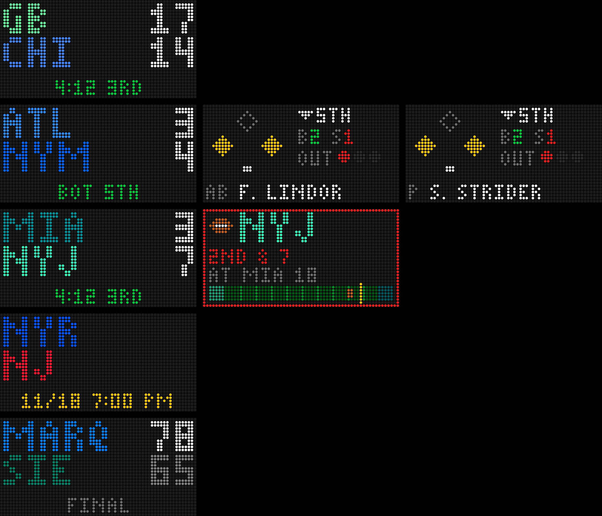

# LED Scoreboard 🏟️

A sports scoreboard for a **Raspberry Pi Zero 2 W** and an **Adafruit RGB LED matrix**.
It cycles through live, upcoming and final scores, and you change its settings from a
web page on your phone, so you never have to open the box.



## What it does

- Shows **just your teams** or **every game** in the leagues you pick
- Teams in team colors, live games in green, start times in yellow, finals in gray (losing team dimmed)
- A settings page at `http://<pi-name>.local:8080` with:
  - which leagues to check and which teams to follow (codes like `NYJ`, or names like `Siena`)
  - brightness, seconds per game, how often to refresh scores
  - show or hide upcoming and finished games
- Leagues: NFL, MLB, NBA, NHL, WNBA, MLS, Premier League, college football,
  men's college basketball (all of Division I), and the USMNT (friendlies, Nations League,
  Gold Cup, World Cup and qualifying). Add more in `scoreboard/leagues.py`.

Scores come from ESPN's public scoreboard feed (no account or API key needed).

## Hardware

- Raspberry Pi Zero 2 W (with headers soldered on) + microSD card
- Adafruit RGB Matrix **Bonnet** (or HAT)
- A 64×32 RGB LED panel (other sizes work: change `panel` in the settings)
- A 5V 4A power supply for the Bonnet's barrel jack. The panel draws a lot more than the Pi.

## Setting up the Pi

1. Flash **Raspberry Pi OS Lite** with Raspberry Pi Imager. In its settings, set the hostname
   (e.g. `scoreboard`), your Wi-Fi, and turn on SSH.
2. SSH in: `ssh pi@scoreboard.local`
3. Get the code and run the installer:
   ```bash
   git clone https://github.com/<your-username>/led-scoreboard.git
   cd led-scoreboard
   bash deploy/install.sh
   ```
4. Open `http://scoreboard.local:8080` on your phone and pick your teams.

## Trying it without a Pi

On any computer with Python 3:

```bash
pip install -r requirements.txt
python3 -m scoreboard.main --console   # draws the panel in your terminal
python3 tools/preview.py               # saves preview.png with sample games
python3 -m unittest discover tests     # runs the tests
```

The settings page also runs at `http://localhost:8080` while it's going.

## How the code is organized

| File | What it does |
|---|---|
| `scoreboard/main.py` | The main loop: get scores, show each one, repeat |
| `scoreboard/espn.py` | Downloads scores and picks which games to show |
| `scoreboard/leagues.py` | The list of leagues and where their scores come from |
| `scoreboard/render.py` | Draws a game onto a 64×32 picture with a tiny pixel font |
| `scoreboard/display.py` | Sends the picture to the LED panel (or the terminal) |
| `scoreboard/web.py` | The settings web page |
| `scoreboard/config.py` | Default settings, and loading/saving `config.json` |

## Day-to-day Git workflow

Make changes on a laptop, push them to GitHub, then pull them onto the Pi:

```bash
# On your laptop
git checkout -b bigger-scores        # start a branch for your idea
# ...edit files...
git status                           # see what changed
git diff                             # see exactly what changed
git add scoreboard/render.py
git commit -m "Make scores bigger"
git push -u origin bigger-scores     # then open a Pull Request on GitHub and merge it

# On the Pi
cd ~/led-scoreboard
git pull
sudo systemctl restart scoreboard
```

`config.json` (your teams and settings) is listed in `.gitignore`, so it stays on the Pi
and `git pull` never overwrites it.

## Handy commands on the Pi

```bash
sudo systemctl status scoreboard     # is it running?
journalctl -u scoreboard -f          # watch its log
sudo systemctl restart scoreboard    # restart after a git pull
```

## Ideas for later

- Show the next game date for favorite teams when they aren't playing today
- Standings, weather, a countdown to a big game
- Scroll long text, team logos, a "game just ended" flash
- A button on the case to switch modes
