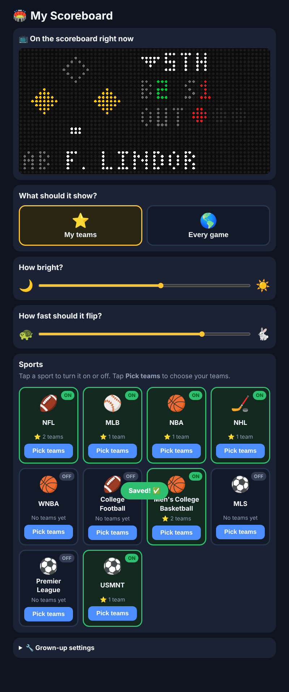
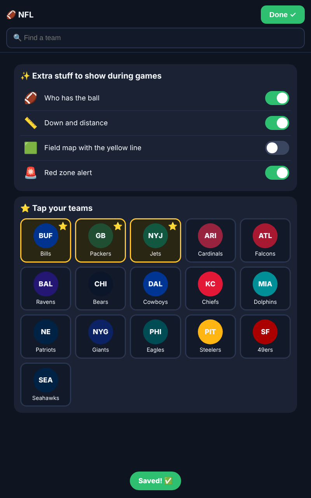

# LED Scoreboard 🏟️

A sports scoreboard for a **Raspberry Pi Zero 2 W** and an **Adafruit RGB LED matrix**.
It cycles through live, upcoming and final scores, and you change its settings from a
web page on your phone, so you never have to open the box.


## What it does

- Shows **just your teams** or **every game** in the leagues you pick
- Teams in team colors, live games in green, start times in yellow, finals in gray (losing team dimmed)
- **Live game details**, each one switchable on or off:
  - ⚾ Baseball: one full screen with the score, top/bottom of the inning, balls and strikes, outs,
    runners on base, and a little ball under the team at bat; the bottom line flips between batter and pitcher
  - 🏈 Football: one full screen with the score, quarter and clock, plus who has the ball, down and distance,
    the ball's spot, a field map with the yellow first-down line, and a red border in the red zone
- A kid-friendly **settings page** for any phone or tablet browser on your Wi-Fi:
  - see what's on the board right now
  - "My teams" or "Every game", a brightness slider, a speed slider
  - turn sports on and off, tap team logos to pick favorites, flip switches for the extra details
  - grown-up settings: board name, refresh rate, show/hide upcoming and finished games

| Settings page | Team picker |
|---|---|
|  |  |
- Leagues: NFL, MLB, NBA, NHL, WNBA, MLS, Premier League, college football,
  men's college basketball (all of Division I), and the USMNT (friendlies, Nations League,
  Gold Cup, World Cup and qualifying). Add more in `scoreboard/leagues.py`.

Scores come from ESPN's public scoreboard feed (no account or API key needed).

## Hardware

- Raspberry Pi Zero 2 W (with headers soldered on) + microSD card
- Adafruit RGB Matrix **Bonnet** (or HAT)
- A 64×32 RGB LED panel (other sizes work: change `panel` in the settings)
- A 5V 4A power supply for the Bonnet's barrel jack. The panel draws a lot more than the Pi.

## Setting up the Pi

1. Flash **Raspberry Pi OS Lite** with Raspberry Pi Imager. In its settings, set the hostname
   (e.g. `scoreboard`), a username and password, your Wi-Fi, and turn on SSH.
2. SSH in: `ssh <username>@scoreboard.local`
3. Get the code and run the installer:
   ```bash
   sudo apt-get install -y git
   git clone https://github.com/<your-github-username>/led-scoreboard.git
   cd led-scoreboard
   bash deploy/install.sh
   ```
   Adafruit's part of the installer asks a few questions: pick **Adafruit RGB Matrix Bonnet**,
   **Convenience**, and **yes** to reboot. It can take ~15 minutes on a Pi Zero.
4. After the reboot the scoreboard starts by itself and shows its address for 10 seconds
   (e.g. `192.168.1.42:8080`). Open `http://192.168.1.42:8080` in a browser on your phone or tablet.

### Using it from a kid's Fire tablet

- Use the **number address** shown on the board, not `scoreboard.local`. Fire tablets usually can't find `.local` names.
- If the tablet uses an **Amazon Kids** profile, the browser only opens approved sites. Add the scoreboard's
  address in the Amazon Parent Dashboard (Web browser → allowed websites).
- Tip: give the Pi a fixed address in your router's settings (often called a "DHCP reservation") so the link never changes.

## Trying it without a Pi

On any computer with Python 3:

```bash
pip install -r requirements.txt
python3 -m scoreboard.main --console   # draws the panel in your terminal
python3 tools/preview.py               # saves preview.png with sample games
python3 tools/preview.py 128           # same, for two chained panels (128x32)
python3 -m unittest discover tests     # runs the tests
```

The settings page also runs at `http://localhost:8080` while it's going.

## How the code is organized

| File | What it does |
|---|---|
| `scoreboard/main.py` | The main loop: get scores, show each one, repeat |
| `scoreboard/espn.py` | Downloads scores and picks which games to show |
| `scoreboard/leagues.py` | The list of leagues and where their scores come from |
| `scoreboard/render.py` | Draws a game onto a 64×32 picture with a tiny pixel font, plus the baseball and football detail pages |
| `scoreboard/display.py` | Sends the picture to the LED panel (or the terminal) |
| `scoreboard/web.py` | The settings page's server and its small JSON API |
| `scoreboard/static/index.html` | The settings page itself (HTML, CSS and JavaScript) |
| `scoreboard/config.py` | Default settings, and loading/saving `config.json` |

## Day-to-day Git workflow

Make changes on a laptop, push them to GitHub, then pull them onto the Pi:

```bash
# On your laptop
git checkout -b bigger-scores        # start a branch for your idea
# ...edit files...
git status                           # see what changed
git diff                             # see exactly what changed
git add scoreboard/render.py
git commit -m "Make scores bigger"
git push -u origin bigger-scores     # then open a Pull Request on GitHub and merge it

# On the Pi
cd ~/led-scoreboard
git pull
sudo systemctl restart scoreboard
```

`config.json` (your teams and settings) is listed in `.gitignore`, so it stays on the Pi
and `git pull` never overwrites it.

## Handy commands on the Pi

```bash
sudo systemctl status scoreboard     # is it running?
journalctl -u scoreboard -f          # watch its log
sudo systemctl restart scoreboard    # restart after a git pull
```

## Adding details for another sport

1. Add the options to `DETAILS` in `scoreboard/leagues.py` (they appear as switches on the settings page automatically).
2. Read the values from ESPN's `situation` block in `parse_situation()` in `scoreboard/espn.py`.
3. Write a `<sport>_pages()` function in `scoreboard/render.py` and add it to `DETAIL_LAYOUTS`.

On a 64-wide panel the details get their own page after the score. On a 128-wide panel (two panels chained,
`chain_length: 2`) they appear next to the score. A sport listed in `FULL_LAYOUTS` (football and baseball) draws its own
score and clock, so its live screen replaces the score page instead.

## Ideas for later

- Show the next game date for favorite teams when they aren't playing today
- Standings, weather, a countdown to a big game
- Scroll long text, team logos, a "game just ended" flash
- A button on the case to switch modes
